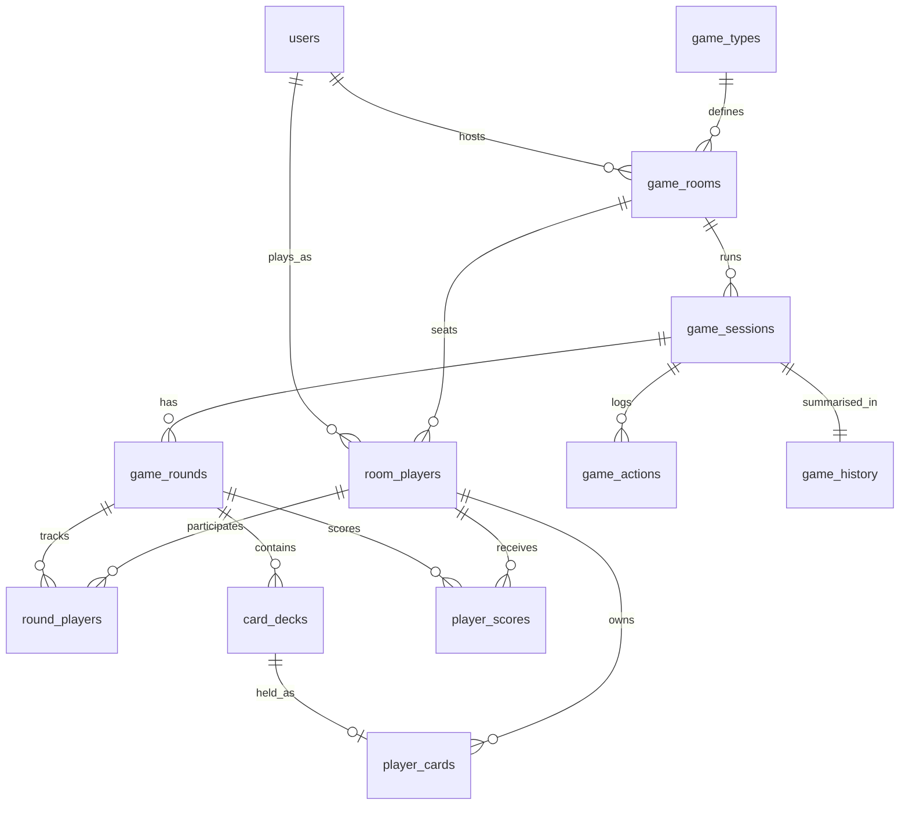

# Architecture

Stack (fixed): Angular (latest stable, TypeScript, HTML, plain CSS, no Tailwind) · Node.js + Express + Socket.IO (plain JavaScript with JSDoc types) · Neon PostgreSQL via `pg` with parameterized SQL · Vercel (frontend) · Render (backend).

## 1. Repository layout

```
cardsGame/
  docs/                         this documentation
  backend/
    package.json
    db/migrations/001_init.sql
    scripts/migrate.js          tiny SQL migration runner (uses pg, no extra deps)
    src/
      server.js                 http + socket bootstrap
      app.js                    express app
      config/                   env, logger
      constants/                error codes, event names, enums
      middleware/               auth, rate limit, error handler, request id
      routes/ controllers/      thin REST layer
      validators/               payload schemas
      db/
        pool.js                 Neon pool + withTransaction()
        repositories/           users, rooms, sessions, rounds, cards, scores, actions
      platform/                 game-agnostic
        room.service.js
        game-session.service.js per-room queue, idempotency, persistence, recovery
        game-registry.js        maps game code -> game module
        timer.service.js        turn timers, reconnect grace
      games/
        set/                    pure engine (no express, no socket.io, no db)
          index.js              exports the GameModule interface
          set.config.js         default config, validation of config
          deck.service.js
          shuffle.service.js
          dealer.service.js
          card-distribution.service.js
          joker.service.js
          life-validation.service.js
          set-validation.service.js
          declaration.service.js
          scoring.service.js
          elimination.service.js
          turn.service.js
          one-card-to-win.service.js
          view.js               viewFor(state, playerId): the only data that leaves the server
      socket/                   thin handlers: auth -> validate -> service -> ack
    tests/
      unit/ integration/
  frontend/                     Angular app
    src/app/
      core/                     socket.service, session.service, game-state store, guards
      features/
        home/ game-select/ lobby/ (create, join, waiting-room)
        table/ (dealer-selection, distribution, game-table, hand, seats)
        results/ (round-result, elimination, winner)
      shared/                   playing-card, card-back, pile, seat, modal, scoreboard, toast
      styles/                   tokens.css, table.css, cards.css
```

## 2. Pluggable game modules

The platform knows nothing about SET. A game is an object:

```js
/** @typedef {Object} GameModule
 *  @property {string} code
 *  @property {(players, config) => State} createGame
 *  @property {(state, playerId, action) => {state, events}} applyAction
 *  @property {(state, playerId) => PlayerView} viewFor
 *  @property {(state) => TimerDirective|null} nextTimer
 */
```

Adding another card game later means adding `games/<name>/` and one registry line. Rooms, sockets, persistence, auth and the Angular lobby are reused.

## 3. Backend request flow

```
socket event ─▶ handler (auth, schema validate)
             ─▶ GameSessionService.perform()   (per-room queue, idempotency)
             ─▶ engine.applyAction()           (pure)
             ─▶ repositories (transaction on critical events)
             ─▶ emit per-recipient views (viewFor)
```

- **Source of truth:** in-memory authoritative state per active room, persisted as `game_sessions.state_snapshot` with a `state_version`.
- **Recovery:** on startup (Render restarts), load sessions with `status = 'in_progress'`, rebuild state from the snapshot, restart timers, and wait for clients to call `resume`.
- **Scaling:** one backend instance owns all live rooms. Horizontal scaling would need a Redis adapter and room sharding. It is out of scope for the first release and documented as a limit.
- **Transactions** wrap: deal (round, card_decks, player_cards, round_players), scoring (player_scores, room_players totals, elimination), round completion, game completion (session, room, game_history).

## 4. Security design

| Concern | Control |
|---|---|
| Card secrecy | `viewFor` is the only projection. Opponents appear as `{ handCount }`. Draw pile = count. Discard pile = top card and count. |
| Identity | Token in handshake, hash stored, `userId` taken from the socket, never from payloads. |
| Room membership | Every handler resolves the player from `(userId, roomCode)` and rejects non-members. |
| Turn integrity | Engine enforces phase (`awaiting-draw` → `awaiting-discard` → `turn-complete`) and active player. |
| Duplicates | `requestId` idempotency plus per-room action queue plus DB unique keys. |
| Scoring integrity | Only `scoring.service` computes points. `player_scores` unique on (round, player). |
| Randomness | `crypto.randomInt` Fisher–Yates for shuffle, dealer pick and joker reveal. |
| Abuse | Payload size limit, schema validation, per-socket rate limit, CORS allow-list for the Vercel origin. |
| Logging | Structured JSON logs with request id, room code and player id. Cards are never logged. |
| Secrets | `DATABASE_URL`, `CLIENT_ORIGIN` from environment only. |

## 5. Frontend architecture

- Standalone Angular components, `OnPush` change detection, signals for state.
- `SocketService` is the only place that touches `socket.io-client`. A `GameStore` holds the latest public view plus private hand and exposes signals to components.
- Reusable components: `playing-card`, `card-back`, `card-hand` (drag to reorder and group), `pile`, `player-seat`, `scoreboard`, `confirm-modal`, `toast`, `joker-badge`.
- One CSS file of design tokens (`tokens.css`) plus one stylesheet per component. Dark-green felt table, responsive down to 360 px, `prefers-reduced-motion` respected. No money or gambling imagery.
- The client **never** validates declarations or computes points. It may disable buttons for UX only.
- Screens: Home, Game Selection, Create Room, Join Room, Waiting Room, Dealer Selection, Card Distribution, Main Table (seats, hand, piles, open joker, buttons), Drop Confirmation, Declaration, Scoreboard, Round Result, Elimination, Final Winner.

## 6. Environments

| Part | Host | Config |
|---|---|---|
| Frontend | Vercel | `environment.apiUrl` pointing at Render. |
| Backend | Render web service (WebSocket-capable) | `DATABASE_URL`, `CLIENT_ORIGIN`, `PORT`, `NODE_ENV`. `/api/health` for health checks. |
| Database | Neon | Pooled connection string. Migrations through `npm run migrate`. |

Render free instances sleep after inactivity and cold-start. Live rooms survive through snapshot recovery, but players may see a brief reconnect. A paid always-on instance avoids that.

## 7. ER diagram



Full DDL: [`backend/db/migrations/001_init.sql`](../backend/db/migrations/001_init.sql).
